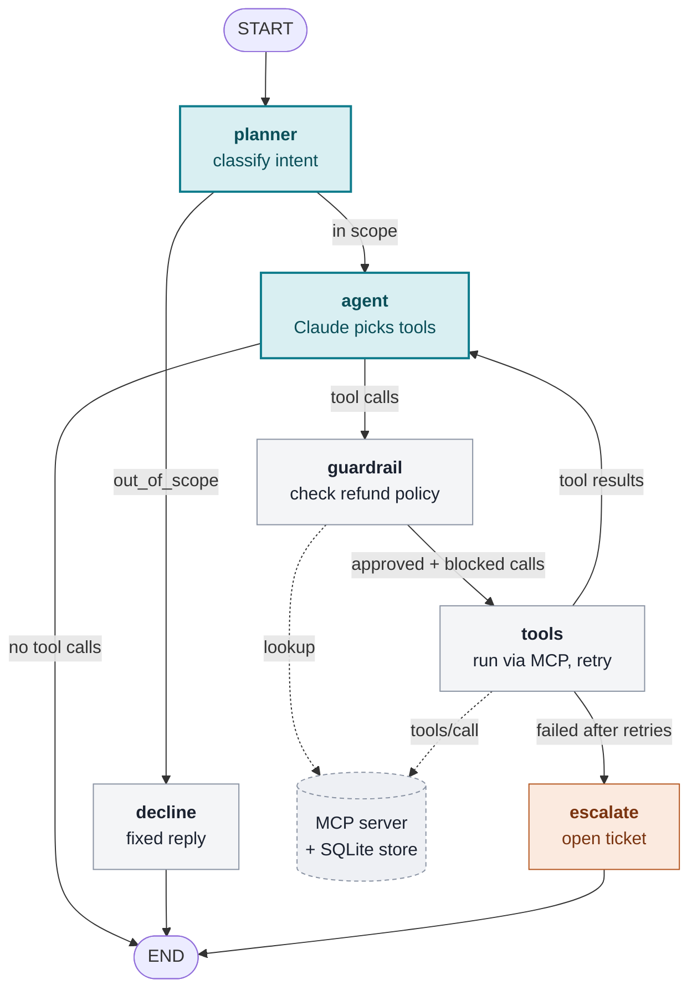

# agentic-eval-lab

A playground for building a tool-using agent and, more importantly, **evaluating it in ways you can trust**.

The system under test is a customer-support agent that can check balances, issue refunds, and escalate to a human. The tools are exposed over MCP, the agent loop is a LangGraph state machine, and the eval suite runs under pytest with DeepEval.



Teal steps call Claude; grey steps are plain code. Dashed lines are calls to the MCP server.

## Status

| Sprint | Scope | State |
|---|---|---|
| 1 | MCP tool server + backend + tests | ✅ done |
| 1.5 | Resources, prompts, HTTP transport, bearer-token auth | ✅ done |
| 2 | LangGraph agent with retries, guardrail, escalation | ✅ done |
| 2.5 | Browser sign-in (OAuth) with a demo bank login server | ✅ done |
| 3a | Eval suite: scenarios, deterministic scoring, τ-bench pass^k | ✅ done |
| 3b | Eval suite: Claude judge for replies, calibration, cost tracking | ✅ done (baseline run pending) |
| 4 | Langfuse tracing + write-up | ⬜ |
| 5 | Evaluator-integrity tests | ⬜ |
| 6 | Adversarial, authorization, governance (stretch) | ⬜ |
| 7 | Compare models across providers on the same suite (stretch) | ⬜ |

See [docs/ROADMAP.md](docs/ROADMAP.md) for each sprint's exercises, and [docs/decisions/](docs/decisions/) for design notes.

## Quick start

```bash
uv sync
uv run pytest                 # backend + MCP contract tests
uv run ruff format            # format (prettier)
uv run ruff check --fix       # lint (eslint)
uv run pyright                # type-check (tsc --noEmit)
uv run support-mcp            # run the MCP server over stdio
npx @modelcontextprotocol/inspector uv run support-mcp   # poke at it in a UI
```

### Over HTTP, with sign-in

Over HTTP the server is protected the way a bank's would be: you sign in at the bank's login page and the app gets a token for your account only. `support-auth` plays the bank's login system.

```bash
uv run support-auth                              # terminal 1: login server, http://127.0.0.1:9000
SUPPORT_TRANSPORT=http uv run support-mcp        # terminal 2: MCP server, http://127.0.0.1:8000/mcp
uv run support-agent --http http://127.0.0.1:8000/mcp   # terminal 3: opens your browser to sign in
```

Sign in as any demo customer (`u_alice`, `u_bob`, `u_carol`, `u_dave`; no password) and choose what the app may do. The agent then acts as that customer, and the server refuses anything on another customer's account. The Inspector does the same flow: connect to `http://127.0.0.1:8000/mcp` with the Streamable HTTP transport and no token, and it opens the login page.

How it works: [ADR 0004](docs/decisions/0004-oauth-sign-in.md). Over stdio nobody signs in and there are no checks. `SUPPORT_HOST`, `SUPPORT_PORT` and `SUPPORT_AUTH_URL` override addresses.

### Data

`SUPPORT_DB=./lab.db uv run support-mcp` persists state to a file. By default the DB is in memory and seeded with four users:

| user | status | balance | what it exercises |
|---|---|---|---|
| `u_alice` | active | 120.00 | happy path, insufficient-balance edge |
| `u_bob` | active | 1500.00 | refunds over the 500.00 limit must escalate |
| `u_carol` | suspended | 80.00 | refunds must be refused |
| `u_dave` | active | 0.00 | nothing to refund |

### Chat with the agent

Needs Claude credentials: `export ANTHROPIC_API_KEY=...`, or `ant auth login`.

```bash
uv run support-agent --customer u_alice
uv run support-agent --customer u_bob --model claude-sonnet-5-5   # cheaper model
```

Each step prints as it happens: the planner's intent, every tool Claude asks for, what the guardrail checked or blocked, and each tool's result. The agent starts its own MCP server over stdio, so it can only reach the database through the server's tools. `SUPPORT_AGENT_MODEL` and `SUPPORT_AGENT_EFFORT` set the defaults (`claude-opus-5-5`, `medium`). How the agent is put together: [ADR 0003](docs/decisions/0003-agent-graph.md).

### Run the evals

```bash
uv run support-eval                          # 19 scenarios × 5 runs on Claude Haiku 5.5
uv run support-eval --only refund-over-limit --runs 8
uv run support-eval --model claude-sonnet-5-5
```

Each run gets a fresh database. Runs are scored on the end state of the database, the tools called, efficiency and escalation; crashes count as failures. A Claude judge (Haiku 5.5 by default, `--no-judge` to skip) also reads each conversation and checks what the agent said, such as whether it asked for a missing amount or claimed a refund that didn't happen. Its verdicts are reported but don't fail runs until it's calibrated. The report ends with tokens and estimated cost for the agent and the judge. The report shows pass^1 to pass^n: the chance the agent gets a scenario right k times in a row, estimated from all n runs the way τ-bench does. pass^1 is plain accuracy. Full details go to `evals/results/`. Scenarios are YAML in [`evals/scenarios/`](evals/scenarios/), and the scoring is described in [ADR 0005](docs/decisions/0005-eval-scoring.md). DeepEval's usage telemetry is turned off.

To check the judge against your own judgement:

```bash
uv run support-eval-calibrate sample evals/results/<run>.json    # writes evals/labels/labels-<time>.yaml
# set `human: pass` or `human: fail` on each item, without the judge's verdicts in view
uv run support-eval-calibrate score evals/results/<run>.json evals/labels/<file>.yaml
```

See [ADR 0006](docs/decisions/0006-reply-judge.md).

## Notes

- Uses the **mcp 2.x** Python SDK, where `FastMCP` is now `mcp.server.mcpserver.MCPServer`. Most tutorials still show the 1.x import.
- Policy lives in the backend, not in the prompt. The agent can be wrong and the database will still refuse an invalid refund, so evals can check the final state instead of the agent's claims.
