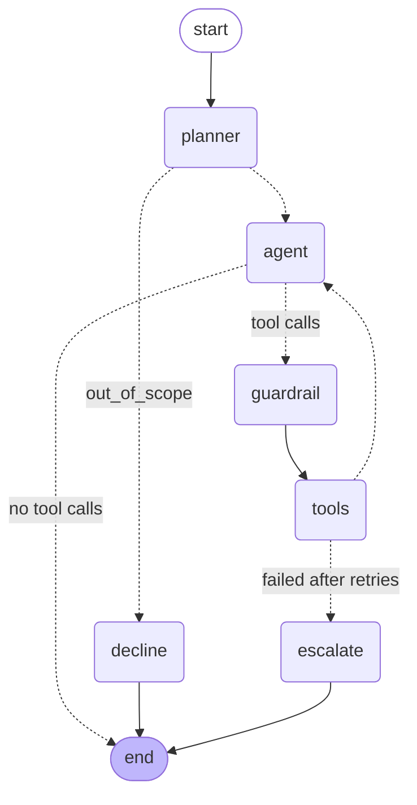

# 0003: The support agent graph

**Status:** accepted (Sprint 2)

## The graph

Generated from the compiled graph with `get_graph().draw_mermaid()`. Dotted edges are conditional.

| Node | Does | Calls the model? |
|---|---|---|
| `planner` | Classifies the latest message (balance, refund, needs_human, general, out_of_scope) from recent text. Only `out_of_scope` changes the route; the intent is recorded for evaluation. | yes, structured output, low effort |
| `decline` | Fixed reply for out-of-scope requests. | no |
| `agent` | One Messages API call with the MCP tools. Its `tool_use` blocks become `pending`. | yes |
| `guardrail` | For each `process_refund`, looks up the account and blocks refunds that are over the limit, over the balance, or on an inactive account. Blocked calls get an error `tool_result` and never reach the backend. | no |
| `tools` | Runs approved calls through MCP, retrying transient failures. | no |
| `escalate` | Opens a ticket when a call still fails after retries, then ends the turn. | no |

## Decisions

**The model is called through the Anthropic SDK, not LangChain.** LangGraph only needs async functions as nodes, so the `agent` node is a direct `messages.create` call. You see the raw `tool_use` / `tool_result` blocks, and nothing sits between the graph and the API. The SDK's tool runner isn't used because the graph *is* the loop; that's the point of this sprint.

**Model blocks are stored exactly as returned.** Claude Opus 5.5 always thinks, and its thinking blocks must be sent back unchanged on the next request. State keeps every content block as the API's dict, never a re-built copy. `fallbacks: "default"` lets the API retry a declined request on another model server-side.

**Errors are split into policy errors and transient failures.** The MCP server prefixes deliberate refusals with a code (`requires_escalation: ...`). A code from the known list is a policy error: returned to the model, never retried. Anything else (no code, unknown code, transport failure) is transient: retried up to `max_retries`, then the `escalate` node opens a ticket without asking the model.

**Refund retries carry an idempotency key.** `tools` adds `idempotency_key = agent-<tool_use id>` to every refund. If the first attempt committed but its response was lost, the retry is replayed by the backend instead of refunding twice (`test_retry_after_lost_response_does_not_refund_twice`).

**The guardrail duplicates backend checks on purpose.** The backend is still the authority (ADR 0001). The guardrail gives the model a clear error before anything runs, and lets evals tell "the agent tried a bad refund and was stopped" apart from "the agent never tried". Its limit is a setting, not an import from the backend, because the agent only reaches the backend through MCP; a test asserts the two values match.

**Every tool call is logged with its source.** `tool_log` records `model`, `guardrail` and `system` calls separately, with attempts, error codes and whether the guardrail blocked them. That log is the trajectory Sprint 3 will score.

## Known gaps

- The planner sees only text. It can misroute a follow-up like "yes, do it" if the earlier turns are ambiguous. Intent accuracy is something Sprint 3 should measure.
- Hitting the step limit leaves the thread with an unanswered `tool_use`, so it can't continue. The runner raises `AgentStepLimitError`, and evals should count it as a failure.
- The agent acts for `customer_id`, but nothing stops it from calling tools on another account. That's Sprint 6's authorization work.
