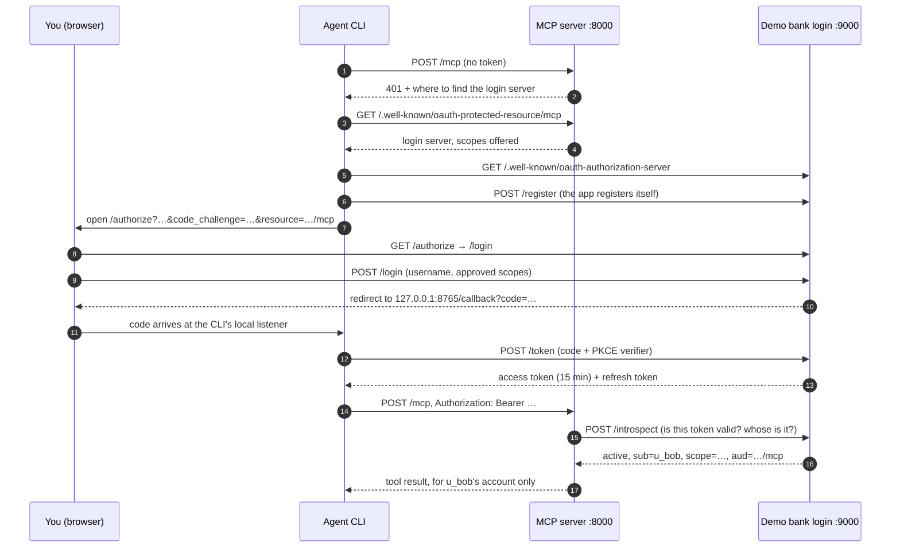

# 0004: Browser sign-in with OAuth

**Status:** accepted (Sprint 2.5). Supersedes the dev tokens in [0002](0002-auth-at-transport-layer.md).

## Context

Over HTTP the server used two hard-coded tokens, and the customer was whatever `--customer` said. A bank wouldn't work that way. The user signs in on the bank's own page, approves what the app may do, and the app receives a token that only works for that user's account. The MCP spec uses standard OAuth for this.

## The flow

## Decisions

**The login server is a separate program.** `support-auth` stands in for the bank's identity system and `support-mcp` is only a resource server: it never sees a password and never issues tokens. That's the split the MCP spec describes, and it's how a real bank would run it.

**The SDK provides the protocol; we provide the bank.** `create_auth_routes` gives discovery metadata, dynamic client registration, `/authorize`, `/token` (including the PKCE check) and `/revoke`. `DemoBankProvider` decides what those endpoints do: send the user to the login page, issue single-use codes, rotate refresh tokens. On the client side, the SDK's `OAuthClientProvider` runs the whole flow for the CLI; `login.py` only opens the browser and listens for the redirect.

**Tokens are checked by introspection.** For each request the MCP server asks the login server about the token (RFC 7662). Tokens are random strings rather than signed JWTs, so revoking one takes effect immediately. The cost is one extra local call per request. The introspection endpoint needs a shared secret, so only the MCP server can use it.

**The token decides who the customer is.** Every tool and `account://` read checks three things: there is a token, it has the tool's scope, and its subject is the account being touched. A token for `u_alice` gets `forbidden` on `u_bob`. The agent learns who it's serving from `session://customer` instead of a command-line flag.

**Tokens are bound to this server.** The client asks for a token for `http://127.0.0.1:8000/mcp` (RFC 8707 `resource`). The SDK's middleware rejects tokens issued for anything else, so a token leaked from another service can't be replayed here.

**The server advertises every scope it offers.** MCP clients request the scopes listed in the protected-resource metadata. The SDK fills that list from `required_scopes`, which is only `accounts:read` here, so clients never asked for `refunds:write`. `http_app()` adds our own metadata route listing all three. Every request still needs only `accounts:read`.

**Consent is real.** The login page lists each scope the app requested; the user can untick refunds and tickets. A token without `refunds:write` can still read balances but gets `forbidden` on refunds.

## What's simplified

- No passwords, two-factor checks or account lockout. Sign-in is a username from a fixed list.
- State is in memory: restarting `support-auth` signs everyone out, and the CLI's tokens last only as long as the process. A real app would keep them in the OS keychain.
- No step-up checks. A bank would ask you to confirm again before a large refund. The MCP spec supports this (a `403 insufficient_scope` that makes the client sign in again for more), and it would be a natural next step.
- Over stdio nobody signs in, so none of these checks apply. The backend still trusts whoever calls it; Sprint 6 moves identity checks into the store itself.
